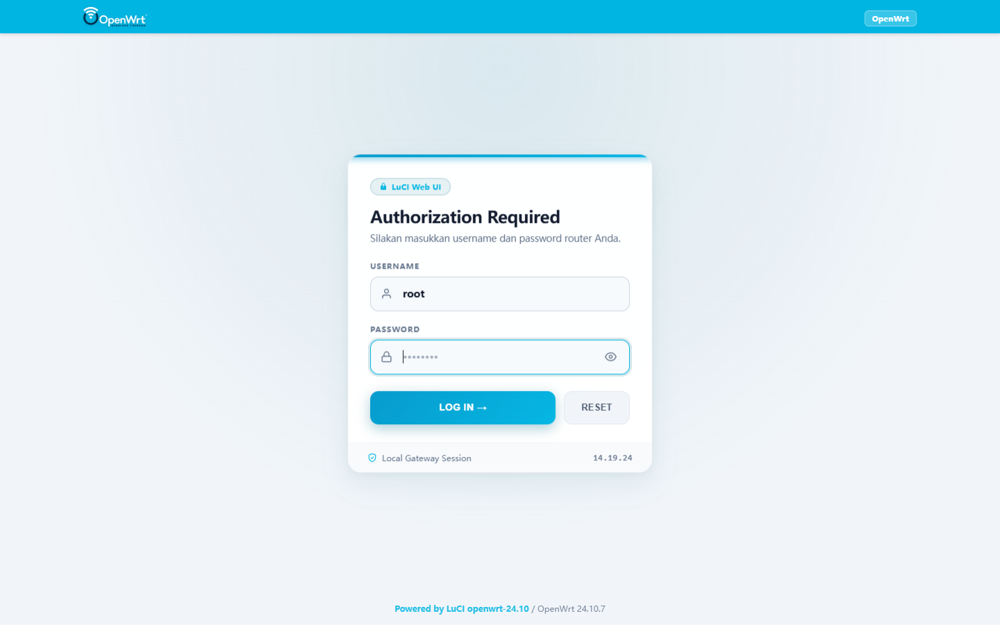
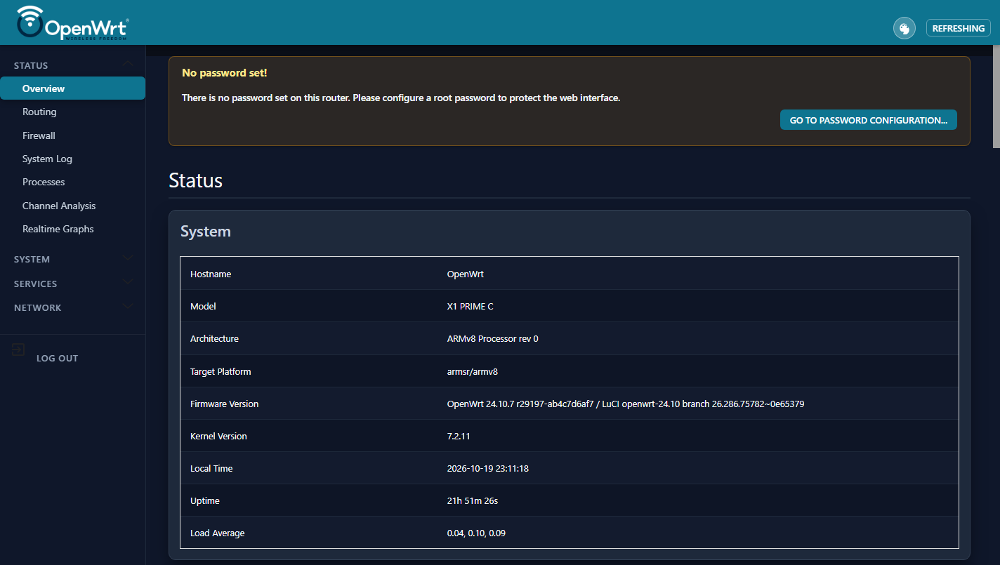
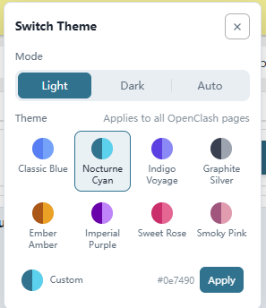

# luci-theme-material

Modern, highly customizable Material Theme for **OpenWrt LuCI** (compatible with OpenWrt 24.10+ / modern ucode & JS architecture).


## 📸 Screenshots

### Harmonized Login Page (Material Light Mode)


### Material Dark Mode Overview


### Real-Time Theme Color Customizer


---

## ✨ Features

- **Harmonized Login Page**: Modern card modal featuring the official Material header bar, OpenWrt brand logo, live digital clock (*HH.mm.ss*), password reveal/hide eye toggle, and theme gradient buttons.
- **Theme Color Customizer**: Dynamic preset & custom color switcher (Nocturne Cyan, Emerald, Sapphire, Violet, Obsidian, etc.) with real-time preview and instant server/client sync.
- **Light & Dark Mode**: Seamless adaptivity for both light and dark environments.
- **Quick Shortcuts Navbar**: Floating and header action pills for quick navigation (OpenClash, File Manager, Terminal, etc.).
- **Pure CSS3 & Modern JS**: Lightweight, fluid animations, no heavy frameworks.

## 📦 Installation

### Option 1: Install Pre-built IPK (Recommended)

1. Download the latest `.ipk` package from [Releases](../../releases).
2. Upload and install on your OpenWrt router:
   ```sh
   opkg update
   opkg install luci-theme-material_*.ipk
   ```
3. Refresh your LuCI browser session.

### Option 2: Build from Source in OpenWrt SDK

1. Place this directory inside `package/feeds/luci/luci-theme-material` or your custom feed.
2. Select it via `make menuconfig`:
   ```
   LuCI --->
     4. Themes --->
       <*> luci-theme-material
   ```
3. Compile:
   ```sh
   make package/luci-theme-material/compile V=s
   ```

## 📄 License

Licensed under the **Apache License 2.0**.
